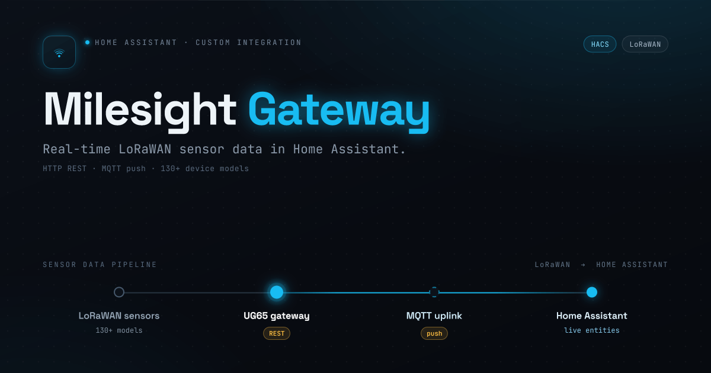

<p align="center">
  
</p>


# Milesight Gateway — Home Assistant Integration

[](https://github.com/corgan2222/ha-milesight-gateway)


A custom Home Assistant integration that bridges **Milesight LoRaWAN gateways** with Home Assistant, providing real-time sensor data from 130+ Milesight LoRaWAN devices.

---

## How It Works

The integration uses two communication channels:

| Channel            | Purpose                                                                                    |
| ------------------ | ------------------------------------------------------------------------------------------ |
| **HTTP REST API**  | Authenticates locally with the gateway (JWT) and fetches the list of connected LoRaWAN devices from the gateway. Only online devices will be synced. Also reads the gateway's status and queues downlinks that change device settings. |
| **MQTT (push)**    | Receives real-time sensor telemetry from LoRaWAN devices via the gateway's uplink topic   |

Device entity definitions are matched from a built-in database of 130+ Milesight device models (`devices_ha.json`). Once matched, the integration automatically creates the appropriate sensor and binary sensor entities for each device.

---


## Requirements

- Home Assistant 2026.9.0 or newer
- A running [MQTT integration](https://www.home-assistant.io/integrations/mqtt/) in Home Assistant
- A Milesight LoRaWAN gateway reachable from your Home Assistant instance
- Gateway credentials (username & password)
- Gateway AES encryption settings (Secret Key & IV — found in the gateway's security settings)
- The gateway must be configured to publish LoRaWAN uplinks to your MQTT broker


---

## Installation

[](https://my.home-assistant.io/redirect/hacs_repository/?owner=corgan2222&repository=ha-milesight-gateway&category=integration)

then 

[](https://my.home-assistant.io/redirect/config_flow_start/?domain=milesight_gateway)


### HACS (Recommended)

1. Open HACS in your Home Assistant sidebar.
2. Go to **Integrations** → click the three-dot menu → **Custom repositories**.
3. Add this repository URL https://github.com/corgan2222/ha-milesight-gateway with category **Integration**.
4. Search for **Milesight Gateway** and install it.
5. Restart Home Assistant.

### Manual

1. Copy the `custom_components/milesight_gateway` folder into your Home Assistant `config/custom_components/` directory.
2. Restart Home Assistant.

---

## Configuration

The integration is configured entirely through the UI — no YAML needed.

### Initial Setup

Go to **Settings → Devices & Services → Add Integration** and search for **Milesight Gateway**.

| Field                      | Description                                                           | Default               |
| -------------------------- | --------------------------------------------------------------------- | --------------------- |
| **Gateway URL**            | IP or hostname of the gateway (e.g. `https://192.0.2.10`)         | —                     |
| **Port**                   | Gateway HTTP API port                                                 | `8080`                |
| **Username**               | Gateway login username                                                | —                     |
| **Password**               | Gateway login password                                                | —                     |
| **Secret Key**             | 16-character AES encryption key (from gateway security settings)      | `1111111111111111`    |
| **IV**                     | 16-character AES initialization vector (from gateway security settings) | `2222222222222222`  |
| **MQTT Uplink Base Topic** | Base MQTT topic where the gateway publishes device data               | `sensors/lora/uplink` |

A second step lists the gateway's devices with a known model. Pick the ones that
should get entities, or leave the list empty for all of them. On a network with
hundreds of sensors, this keeps Home Assistant from creating them all first.
The list is searchable by name, model and devEUI, and the choice can be changed
later in the options.

> Use **Reconfigure** to change the gateway URL, port, credentials, Secret Key, IV, or MQTT topic at any time — existing devices and entities are kept. Leave the password field empty to keep the stored password.

### Options

After setup, open **Configure** on the integration entry:

| Option                         | Description                                                                 | Default | Min  |
| ------------------------------ | --------------------------------------------------------------------------- | ------- | ---- |
| **Polling interval**           | How often to re-fetch the device list from the gateway (seconds)            | `300`   | `60` |
| **Status interval**            | How often to read the [gateway status](#gateway-status) (seconds)           | `300`   | `60` |
| **Read the web interface**     | Log in to the gateway's web interface for CPU, memory, storage, uptime and serial number | on | |
| **Check for new firmware**     | Look up the newest gateway firmware on milesight.com                         | on      |      |
| **Devices**                    | Only the picked devices get entities. The list is searchable by name, model and devEUI | all |  |

> The polling interval only controls the device list. Sensor state updates are pushed via MQTT and are always real-time.

Switching a source off removes the entities that only it could fill; switching
it back on brings them back with the same entity IDs. Entries created before
the status interval existed keep using the polling interval for it.

A device you take out of the **Devices** list is removed from Home Assistant
with its entities; a device that is only offline is not affected. The list can
only be shown while the integration is loaded, since it comes from the gateway.

---

## Entities

### Gateway Diagnostic Sensors

These entities represent the gateway itself and are always created:

| Entity              | Description                                    | Unit    |
| ------------------- | ---------------------------------------------- | ------- |
| **Online Devices**  | Number of devices currently online             | count   |
| **Offline Devices** | Number of devices currently offline            | count   |
| **Response Time**   | TCP round-trip time to the gateway API         | ms      |

### Gateway Status

Read with the status interval from the [options](#options). A failing status call
only makes these entities unavailable, never the device entities.

From the network server API:

| Entity                         | Description                                                        |
| ------------------------------ | ------------------------------------------------------------------ |
| **Uplinks / Downlinks per minute** | Packets in the gateway's packet log since the last update. Unknown after a restart until the second update |
| **Packet forwarder**           | Whether the packet forwarder reaches its network server            |
| **Pending packets**            | Packets waiting in the forwarder's retransmission queue            |
| **MQTT _application_**         | One per application that has devices: whether its MQTT link reaches the broker (attribute `broker`). Several can be active at once, each forwarding its own devices |
| **Radio**, **Radio last seen** | Per gateway the network server receives from. The local gateway's go on the gateway device, others get their own device |
| **Applications**, **Payload codecs**, **Device profiles** | Counts, for diagnosis                           |
| **Codec library version**      | Version of the gateway's payload codec library                     |

From the gateway's web interface, which uses its own login with the same account
as the API. The session is kept and reused; it does not log you out of the web
interface in your browser. If the web interface refuses the account, the
integration logs one warning and does not try again until it is reloaded,
because the gateway locks an account after a few failed logins. Switch off
**Read the web interface** in the options to skip the login and these entities.

| Entity                    | Description                                   |
| ------------------------- | --------------------------------------------- |
| **CPU load**              | %                                             |
| **Memory available**      | %                                             |
| **Storage available**     | eMMC, %                                       |
| **Last boot**             | From the gateway's uptime, to the minute       |

The same login fills the gateway device's model number, serial number and hardware
version.

The gateway reports times without a zone; they are read in Home Assistant's time
zone.

### Gateway Firmware

The **Firmware** update entity shows whether Milesight offers newer firmware for the
gateway. It is checked every 12 hours.

- The installed version comes from the gateway's web interface (`/islogin`), which
  reports it without a login. The network server API on port 8080 has no call for it.
  The same call gives the model (for example UG65); both are shown on the gateway
  device and follow a firmware upgrade at the next check.
- The newest version comes from Milesight's
  [firmware download page](https://www.milesight.com/support/resources/firmware). It is
  matched by the first part of the version (60 for the UG65 and UG67), not by product
  name. Milesight's upgrade notes, such as a required minimum version, appear as the
  release summary, and the release notes are linked.
- Installing stays manual: download the `.bin` file and upload it under
  **Maintenance → Upgrade** on the gateway. Milesight recommends asking their support
  before upgrading.
- Milesight offers no API for this, so the entity reads the download page. If
  Milesight redesigns that page, the latest version shows as unknown until the
  integration is updated.
- Switch off **Check for new firmware** in the options to never contact
  milesight.com. The entity goes away; model and installed firmware stay on the
  gateway device.

### Per-Device Sensors

For each discovered LoRaWAN device, entities are created based on the device model's capabilities.

#### Measurement Sensors (`sensor` platform)

| Key                   | Description                | Unit | Device Class           |
| --------------------- | -------------------------- | ---- | ---------------------- |
| `battery`             | Battery level              | %    | `battery`              |
| `temperature`         | Temperature                | °C   | `temperature`          |
| `humidity`            | Relative humidity          | %    | `humidity`             |
| `co2`                 | CO₂ concentration          | ppm  | `carbon_dioxide`       |
| `pressure`            | Atmospheric pressure       | hPa  | `atmospheric_pressure` |
| `rssi`                | Signal strength            | dBm  | `signal_strength`      |
| `loRaSNR` / `snr`     | LoRa signal-to-noise ratio | dB   | —                      |
| `people_total_counts` | People counted in the area | —    | —                      |
| `valve_opening`       | Valve position of a radiator thermostat | % | —                  |

Every device also gets **Spreading factor** and **Frequency** (disabled by default)
from its newest uplink in the gateway's packet log.

#### Binary Sensors (`binary_sensor` platform)

| Key                         | Description                         | Device Class |
| --------------------------- | ----------------------------------- | ------------ |
| `occupancy`                 | Room occupancy                      | `occupancy`  |
| `people_total_counts`       | Occupied while the count is above 0 | `occupancy`  |
| `pir` / `pir_trigger`       | Motion detection                    | `motion`     |
| `door`                      | Door/window contact                 | `door`       |
| `liquid` / `leakage_status` | Water/liquid leakage                | `moisture`   |
| `tamper` / `tamper_status`  | Tamper detection                    | `tamper`     |
| `window_detection`          | Open window, detected by a thermostat from a temperature drop | `window` |

#### Buttons (`event` platform)

Wireless buttons such as the WS101 get an event entity with the device class
`button`. Each press fires `single_press`, `long_press` or `double_press`, which
automations can use as a trigger. A retained MQTT message is an old press and
does not fire.

#### Special Sensors

| Entity          | Description                                                   |
| --------------- | ------------------------------------------------------------- |
| **Last Seen**   | Timestamp of the last MQTT message received from the device   |

> Metadata entities (devEUI, serial number, application name, etc.) are created as diagnostic sensors but disabled by default.

---

## Device Control

Settings go to a device as a **downlink**. The integration queues it on the
gateway, and the gateway encodes it with the payload codec assigned to the
device. A LoRaWAN device only listens right after it sends, so the change takes
effect after the device's next uplink. The entity shows the new value as soon
as the gateway has queued it. If the gateway does not take the command, the
action fails with an error and the entity keeps its old value.

A device reports its settings only in a status report, not in every uplink.
Until one arrives, a setting shows as unknown; it can be changed anyway. On
thermostats, **Request status report** asks for one.

### Radiator thermostats (WT101)

| Entity | Platform | What it does |
| ------ | -------- | ------------ |
| Thermostat | `climate` | Current and target temperature. Modes: **Heat** (manual, the target temperature applies), **Auto** (the device's own schedule) and **Off** (temperature control disabled). Shows heating while the valve is open |
| Request status report, Calibrate valve, Sync time, Reboot | `button` | One-shot commands |
| Child lock, Open window detection, Freeze protection, Display ambient temperature, Report on change, Outside temperature control, Temperature calibration | `switch` | On/off settings |
| Valve control algorithm, Offline control mode, Window open valve strategy | `select` | Settings with fixed choices |
| Reporting interval, Window detection threshold and time, Freeze protection temperature, Outside temperature timeout, Temperature calibration value, Target temperature min/max | `number` | Numeric settings, in the device's units and ranges |
| Manual valve opening | `number` | Moves the valve directly; the thermostat follows it while its own temperature control is off |
| Outside temperature | `number` | Feeds a room temperature from another sensor, for example by an automation, while **Outside temperature control** is on. The thermostat falls back to its own sensor when no value arrives within the timeout |

The valve position stays unknown until the thermostat is mounted on a valve and
calibrated.

### Other models

| Model | Settings |
| ----- | -------- |
| AM307, AM307L, AM308, AM308L | Reporting interval (seconds), buzzer, LED indicator |
| EM300-MLD, EM300-SLD, EM300-TH | Reporting and collection interval |
| VS321 | Reporting interval, detection mode, collection interval |
| VS340, VS341 | Reporting interval, vacancy reporting interval, LED indicator |
| VS350 | Reporting interval |
| WS203 | Reporting, collection and vacancy reporting interval, LED indicator |

A device can only take settings if the payload codec assigned to it on the
gateway has an encoder. Some codecs ship without one; those devices get no
setting entities.

---

## Supported Devices

**I could only test a few sensors! Some sensor types may not work, or individual data points may be missing**

The integration includes a built-in database of 130+ Milesight LoRaWAN device models. Device matching is done automatically by devEUI prefix. Supported families include:

- **AM series** — Ambience monitoring (temperature, humidity, CO₂, TVOC, light, pressure)
- **CT series** — CO₂ sensors
- **PT series** — Pressure sensors
- **HR series** — Humidity & temperature sensors
- **PM / PM25 series** — Particulate matter sensors
- **AT series** — Ambient temperature sensors
- Motion, occupancy, door/window, water leakage, and more

If a device's devEUI prefix is not found in the database, it will be skipped (a debug message is logged).

---

## Custom Payload Codec Library

The standard Milesight codecs only expose a subset of available sensor datapoints — metadata like device name, devEUI, gateway, RSSI, SNR, and timestamps are missing from the uplink payload.

This integration is designed to work with a custom **[Payload Codec Library](https://github.com/corgan2222/codec)** that enriches every uplink with the full set of available fields.

**Standard Milesight codec output (before):**

```json
{
  "battery": 96,
  "co2": 421,
  "humidity": 56,
  "light_level": 4,
  "pir": 1,
  "pressure": 1025.4,
  "temperature": 27.8
}
```

**With the custom codec (after):**

```json
{
  "devEUI": "24e124707e111005",
  "deviceName": "Multisensor AM307L",
  "type": "AM307L",
  "gw": "Local Gateway",
  "mac": "24e124fffef8706c",
  "timestamp": "2024-09-17T18:04:35.151882Z",
  "applicationID": 5,
  "applicationName": "cloud",
  "loRaSNR": 10.5,
  "rssi": -89,

  "battery": 96,
  "co2": 421,
  "humidity": 56,
  "light_level": 4,
  "pir": 1,
  "pressure": 1025.4,
  "temperature": 27.8,
  "tvoc": 1
}
```

The enriched payload enables all diagnostic entities (RSSI, SNR, Last Seen, device metadata) and additional sensor fields like `tvoc` that the standard codec omits.

**Installation:** Download a release from [github.com/corgan2222/codec](https://github.com/corgan2222/codec) and install it via the **Payload Codec** configuration page on your Milesight gateway.

---

## Troubleshooting

When you open an issue, attach the diagnostics: **Settings → Devices & Services
→ Milesight Gateway → ⋮ → Download diagnostics**. The file shows which device
models were matched, the options and the gateway status. Passwords, keys,
addresses, serial numbers, EUIs and names are removed before the download.

### Integration fails to set up

- Verify the gateway URL, port, and credentials are correct.
- Confirm the gateway is reachable from your Home Assistant host.
- Check that the Secret Key and IV match the gateway's AES settings.

### Entities of a device are unavailable

A device's entities are unavailable while the gateway cannot be reached, or while
the gateway lists the device as inactive. They come back with the next device
list refresh (every 5 minutes by default) once both are fine again.

### No sensor data / entities stuck as unknown

- Confirm the MQTT integration is running in Home Assistant.
- Verify the MQTT broker is receiving uplink messages from the gateway.
- Check that the **MQTT Uplink Base Topic** matches the topic the gateway publishes to (full topic per device is `{base_topic}/{devEUI}`).

### Devices not appearing

- Only active/online devices are imported. Offline devices are skipped.
- If a device model is not in the built-in database, it will be silently skipped. Enable debug logging for `custom_components.milesight_gateway` to see which devices were not matched.

### Firmware entity unavailable or unknown

- **Unavailable:** the gateway's web interface or Milesight's download page could not be
  reached. The gateway URL is used without the API port, so the web interface must be
  reachable there (port 80 for `http://`, 443 for `https://`). The entity retries every
  12 hours; the rest of the integration is not affected.
- **Unknown latest version:** the download page lists no firmware for the gateway's
  version family, or its layout changed.

### A setting shows unknown or does not change

- Settings appear once the device sends a status report. Press **Request status
  report** where the device has one, or wait for the device to send one.
- A change reaches the device after its next uplink. A device that reports every
  10 minutes takes up to 10 minutes to apply a change.
- If the device never applies a change, check on the gateway which payload
  codec is assigned to it. The codec must have an encoder for the setting.

### Updating the connection

- Use **Settings → Devices & Services → Milesight Gateway → Reconfigure** to change the gateway URL, port, username, password, Secret Key, IV, or MQTT topic without removing the integration. Your devices, entities and their history are kept.
- If the gateway moved to a different IP address, this is the place to correct it — the entry will reconnect after the reload.

---

## Removal

1. Go to **Settings → Devices & Services → Milesight Gateway**.
2. Open the **⋮** menu on the integration entry and choose **Delete**.

This removes the config entry together with every device and entity it created.
No settings are left behind on the gateway itself, and the gateway keeps
publishing to MQTT — stop that in the gateway's own configuration if you no
longer want the uplinks.

If you installed through HACS and want the files gone as well, open **HACS →
Milesight Gateway → ⋮ → Remove** afterwards and restart Home Assistant.

---

## Roadmap / ToDo

- **Auto-discover MQTT topic** — read the uplink topic directly from the gateway API instead of requiring manual configuration
- **Thermostat heating schedules** — the WT101's weekly schedule and heating period are not exposed yet

---

## Contributing

See [CONTRIBUTING.md](CONTRIBUTING.md) for guidelines on how to contribute to this project.


## Credits

This integration is built on top of my [Milesight-Gateway-API](https://github.com/corgan2222/Milesight-Gateway-API) Python package, which handles authentication and communication with the Milesight gateway HTTP API.

https://pypi.org/project/Milesight-Gateway-API/

```bash
pip install Milesight-Gateway-API
```

---

## License

This project is licensed under the terms in [LICENSE](LICENSE).
