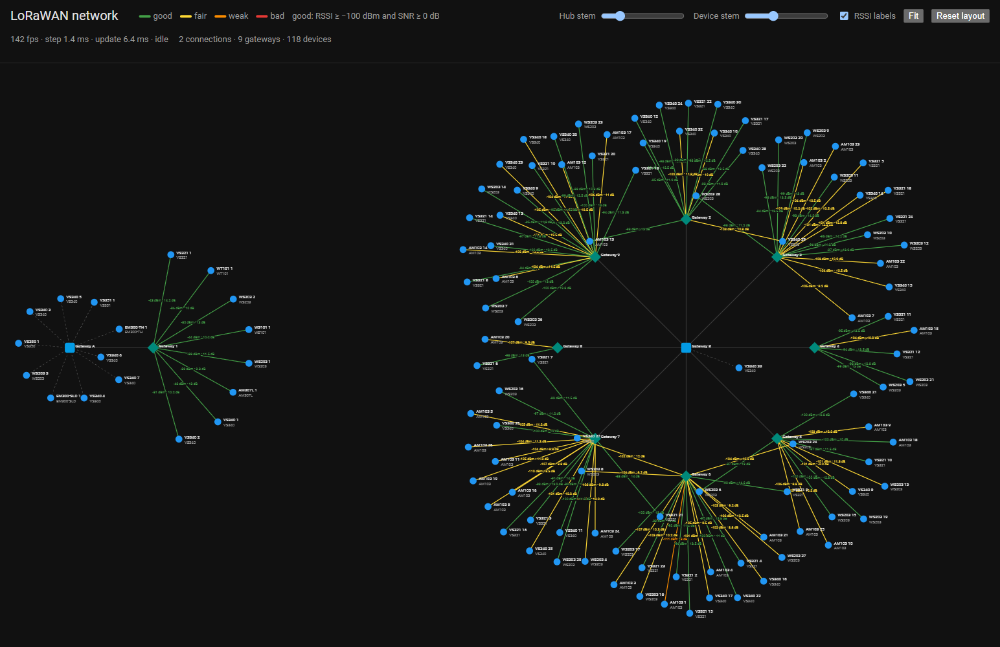
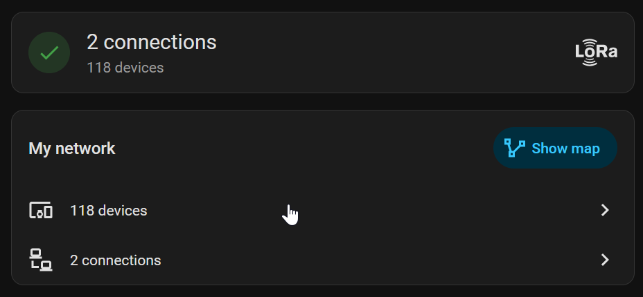
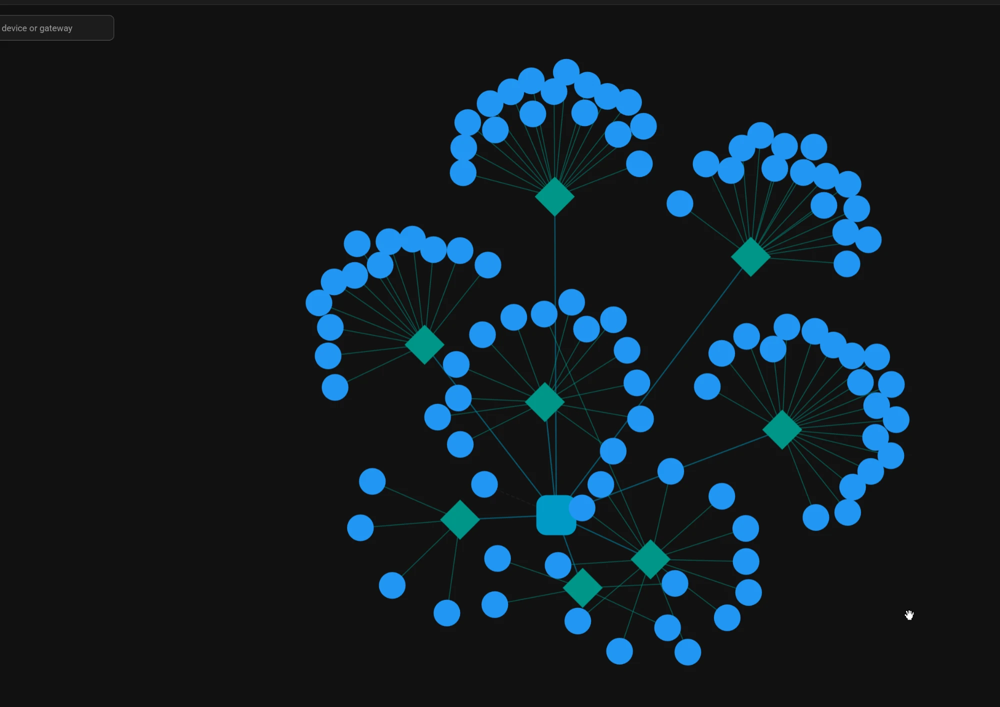
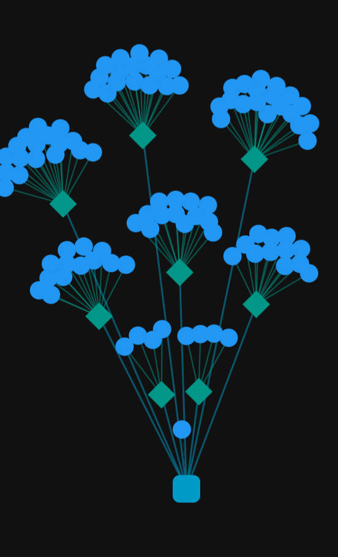
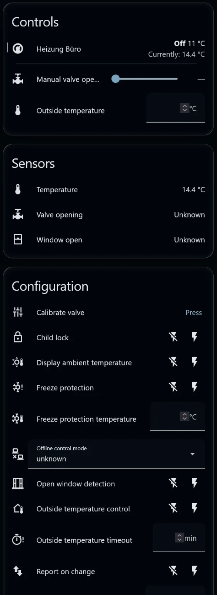
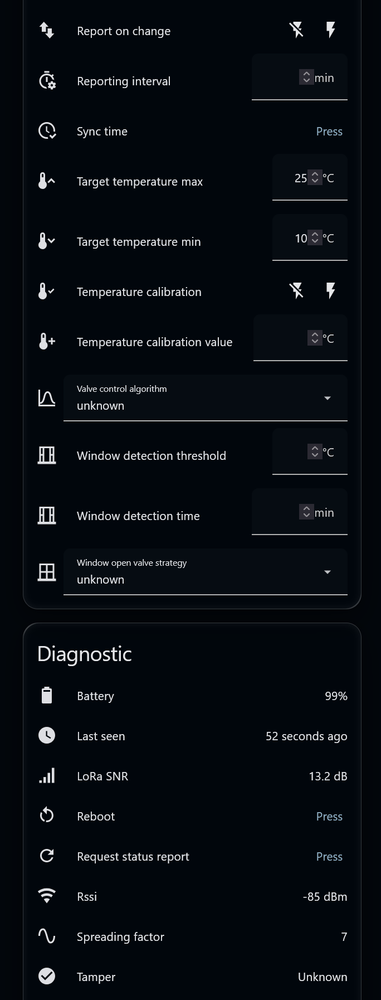

<p align="center">
  
</p>

# Milesight Gateway for Home Assistant

[](https://my.home-assistant.io/redirect/hacs_repository/?owner=corgan2222&repository=ha-milesight-gateway&category=integration)
[](https://my.home-assistant.io/redirect/config_flow_start/?domain=milesight_gateway)

Brings Milesight LoRaWAN gateways (UG65, UG67 and their relatives) and the
sensors behind them into Home Assistant: sensor values, device settings, the
gateway's own status and a map of the radio network.



## Features

- **Sensors of 145 Milesight models**, decoded with Milesight's own codecs
- **No MQTT broker needed**: values come from the gateway's packet log. MQTT stays available
- **Device control**: settings and commands go to the devices as downlinks, a thermostat for the WT101
- **Network map** as a sidebar panel and a dashboard card, with RSSI and SNR per reception
- **Gateway status**: packet forwarder, MQTT links, fleet gateways, packet rates, CPU, memory, storage, firmware updates
- **Device selection**: on a fleet with hundreds of sensors, only the picked ones get entities
- Set up entirely in the UI; diagnostics download with credentials and identifiers removed

## Requirements

- Home Assistant 2026.9.0 or newer
- A Milesight LoRaWAN gateway with firmware 60.0.0.42 or newer, reachable from Home Assistant
- The gateway's login and its AES Secret Key and IV (from the gateway's security settings)
- For the MQTT data source only: the [MQTT integration](https://www.home-assistant.io/integrations/mqtt/) and the gateway publishing uplinks to your broker

## Installation

The integration is in the HACS default list. In HACS, search for **Milesight
Gateway**, download it and restart Home Assistant. Or use the first button
above.

Without HACS, copy `custom_components/milesight_gateway` into your
`config/custom_components/` folder and restart.

## Setup

**Settings → Devices & services → Add integration → Milesight Gateway**, or the
second button above.

| Field | Description | Default |
| ----- | ----------- | ------- |
| Gateway URL | `http://` or `https://` and the address, without port, for example `https://192.0.2.10` | |
| Port | Port of the gateway's HTTP API | `8080` |
| Username, password | The gateway login | |
| Secret Key, IV | 16 characters each, from the gateway's security settings | `1111111111111111`, `2222222222222222` |
| MQTT uplink base topic | Only for the MQTT data source | `sensors/lora/uplink` |

A second step asks for the data source and lists the gateway's devices,
searchable by name, model and devEUI. Pick the ones that should get entities,
or leave the list empty for all.

**Reconfigure** changes the address, port, login, key, IV or topic later and
keeps all devices and entities. An empty password field keeps the stored one.

## Data sources

Each gateway entry uses one of two sources for sensor values:

| | LoRaWAN | MQTT |
| --- | --- | --- |
| How values arrive | The integration reads the network server's packet log every 10 seconds | The gateway publishes each uplink to your broker |
| Decoded by | Milesight's own codecs, bundled in [Milesight-Gateway-API](https://github.com/corgan2222/Milesight-Gateway-API) | The payload codecs set up on the gateway |
| Which entities | Milesight's codec catalog: a reading once the device reports it, the essential settings from the start | A built-in list of 130+ models (`devices_ha.json`) |
| Default | New entries | Entries from before 1.5 |

Switch the source under **Configure**. Fields both sources know keep their
entity, entity ID and history; entities only the other source provides are
removed. On Home Assistant 2026.11 or newer, a LoRaWAN gateway also registers
with Home Assistant's own LoRaWAN integration.

With MQTT, the [enriched payload codecs](https://github.com/corgan2222/codec)
add devEUI, gateway, RSSI, SNR and timestamp to every uplink, which the stock
Milesight codecs leave out.

## Options

| Option | Description | Default |
| ------ | ----------- | ------- |
| Data source | LoRaWAN or MQTT, see above | LoRaWAN for new entries |
| Devices | Only these devices get entities. A device taken out is removed with its entities | all |
| Entities for all device settings | LoRaWAN only. Adds about 25 settings per device, disabled until you enable them | off |
| Polling interval | How often the device list is read, in seconds (min. 60) | `300` |
| Status interval | How often the gateway status is read, in seconds (min. 60) | `300` |
| Read the web interface | Logs in to the gateway's web interface for CPU, memory, storage, uptime and serial number | on |
| Check for new firmware | Looks up the newest gateway firmware on milesight.com | on |

The polling interval only covers the device list. Sensor values arrive as the
devices send them.

## Network map

With the LoRaWAN source, a **LoRaWAN network** panel appears in the sidebar
(picture at the top). It shows every gateway of each entry, a fleet hub's
silent ones too, and the devices around the gateway that hears them best. Each
reception is a line with RSSI and SNR, coloured by the weaker of the two:

| Colour | RSSI | SNR |
| ------ | ---- | --- |
| green | from −100 dBm | from 0 dB |
| yellow | from −110 dBm | from −5 dB |
| orange | from −120 dBm | from −10 dB |
| red | below | below |

Nodes can be dragged, a double-click lets one go back. Two sliders set the
length of the stems to the gateways and to the devices. The same map works as
a dashboard card, loaded by the integration itself:

```yaml
type: custom:milesight-lorawan-map
gateway: https://192.0.2.10   # entry title or ID; all entries when left out
height: 500px
title: Fleet                   # empty hides the title
labels: true                   # RSSI and SNR on the lines
```

On Home Assistant 2026.11 or newer, the same gateways and devices also show up
in Home Assistant's own LoRaWAN integration:

| Overview | Network map | Fleet |
| -------- | ----------- | ----- |
|  |  |  |

## Devices and entities

Every device gets its readings as sensors and binary sensors, buttons such as
the WS101 an event entity (`single_press`, `double_press`, `long_press`), and a
**Last seen** sensor. Spreading factor and frequency of the newest uplink are
diagnostic entities; RSSI and SNR are too with MQTT and the enriched codecs,
and with LoRaWAN they are on the network map.

### Settings and commands

Settings go to a device as a downlink. A LoRaWAN device only listens right
after it sends, so a change takes effect after its next uplink. The entity
shows the new value right away. If the gateway refuses the command, the action
fails and the entity keeps its old value.

Most devices report their settings only when asked, so a setting can show as
unknown until then; it can be changed anyway. **Request status report** asks
for one. With LoRaWAN, settings and alarms keep their last value over a
restart.

### WT101 radiator thermostat

| Controls and sensors | Settings and diagnostics |
| -------------------- | ------------------------ |
|  |  |

- The thermostat sets the target temperature. With LoRaWAN, setting a target
  also switches the valve from manual mode to regulation, and the heating
  state comes from the motor position.
- Child lock, freeze protection, open window detection, outside temperature
  control, calibration and the target range are switches and numbers.
- **Manual valve opening** moves the valve directly while temperature control
  is off. **Outside temperature** feeds a room temperature from another
  sensor, for example by an automation.
- The valve position stays unknown until the thermostat is mounted and
  calibrated.

## Gateway

The gateway device carries:

- **Online and offline devices**, **response time** of the API
- **Packet forwarder**, **pending packets**, **uplinks and downlinks per minute**
- **MQTT link** per application with devices, and one device per fleet gateway with its state and last seen time
- **CPU load**, **memory** and **storage available**, **last boot**, plus model, serial number and hardware version on the device page. These need **Read the web interface**; after one refused login the integration stops trying until it is reloaded, because the gateway locks an account after a few failed logins.
- **Firmware**: an update entity that compares the installed firmware with Milesight's download page every 12 hours. Installing stays manual: download the `.bin` and upload it under **Maintenance → Upgrade** on the gateway.

A failing status call makes only these entities unavailable, not the devices.

## Troubleshooting

Attach the diagnostics to an issue: **Settings → Devices & services →
Milesight Gateway → ⋮ → Download diagnostics**. Passwords, keys, addresses,
serial numbers, EUIs and names are removed.

- **Setup fails:** check address, port, login, Secret Key and IV, and that Home Assistant reaches the gateway.
- **A device's entities are unavailable:** the gateway is unreachable or lists the device as inactive. They come back with the next device list.
- **No values with MQTT:** the MQTT integration must run, and the base topic must match what the gateway publishes (`{base_topic}/{devEUI}`).
- **A device is missing:** offline devices and models without a definition are skipped. Debug logging for `custom_components.milesight_gateway` names them.
- **A setting does not change:** it reaches the device after its next uplink. With MQTT, the payload codec assigned on the gateway needs an encoder.
- **Firmware unavailable:** the web interface must be reachable at the gateway URL without the API port (80 or 443).

## Removal

**Settings → Devices & services → Milesight Gateway → ⋮ → Delete** removes the
entry with all its devices and entities. Nothing is left on the gateway; stop
its MQTT publishing there if you no longer need it. To remove the files, use
**HACS → Milesight Gateway → ⋮ → Remove** and restart.

## Contributing and credits

See [CONTRIBUTING.md](CONTRIBUTING.md). The gateway communication lives in
[Milesight-Gateway-API](https://github.com/corgan2222/Milesight-Gateway-API)
([PyPI](https://pypi.org/project/Milesight-Gateway-API/)). The device decoders
are Milesight's own, from [Milesight-IoT/codec](https://github.com/Milesight-IoT/codec) (MIT).

Only a few of the supported sensor models have been tested on real hardware.
If a model misses a value, please open an issue with the diagnostics.

## License

See [LICENSE](LICENSE).
