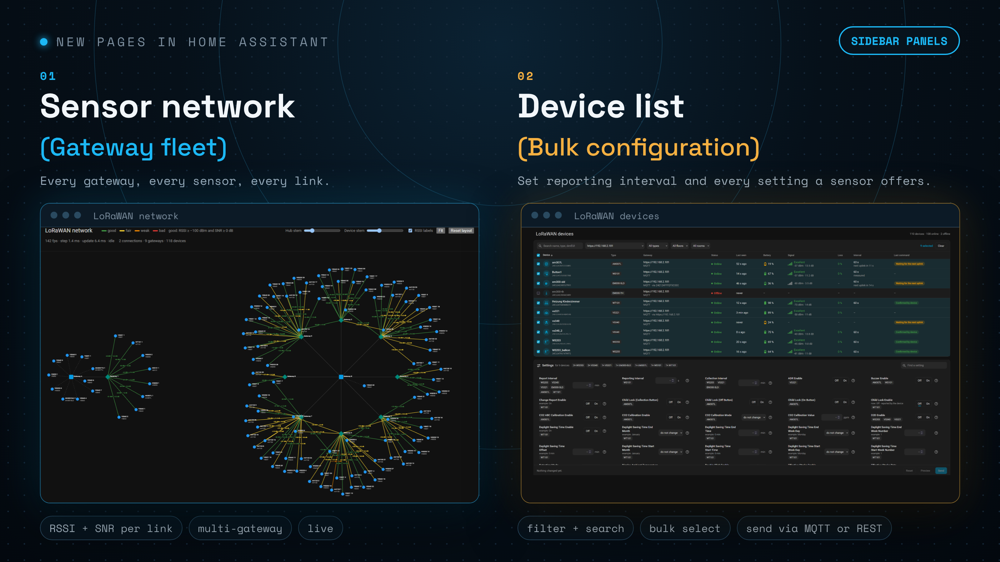
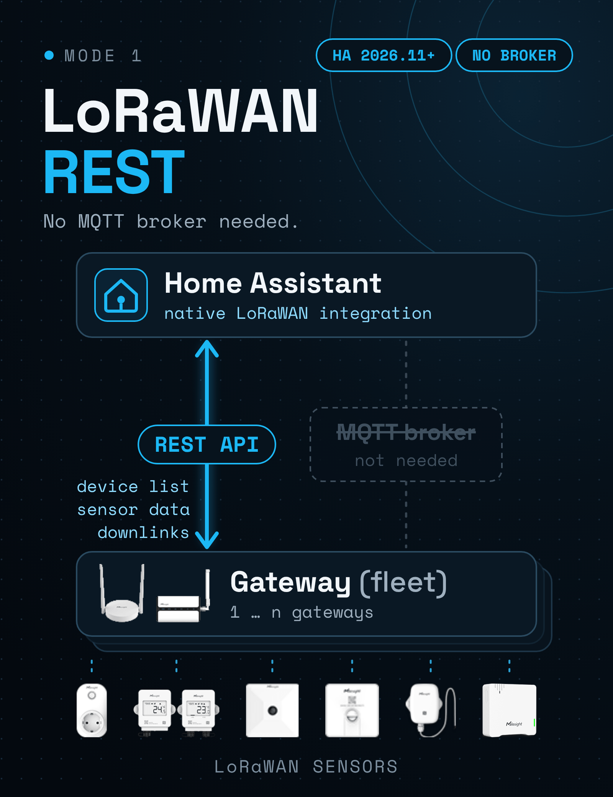
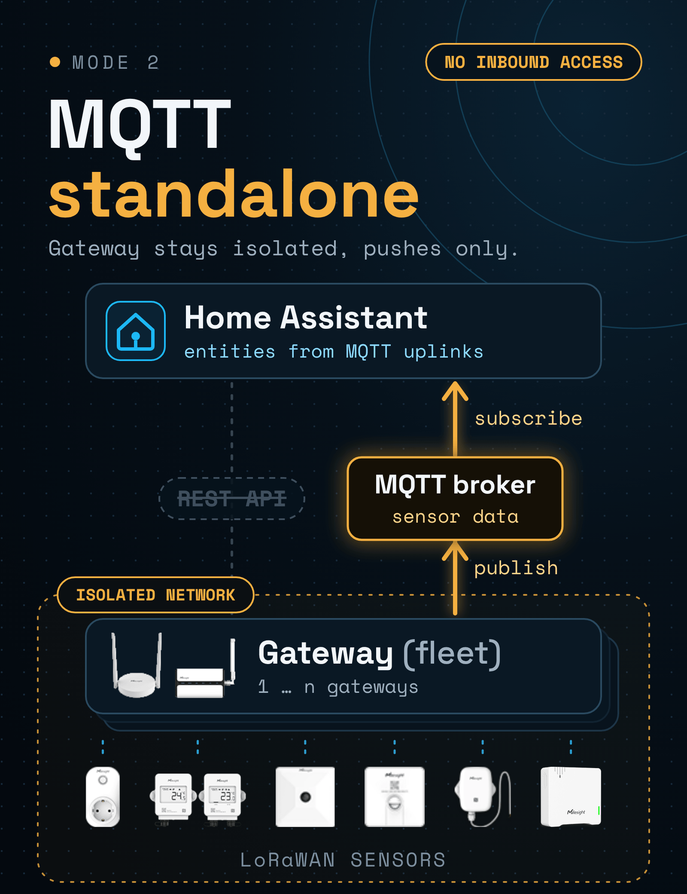
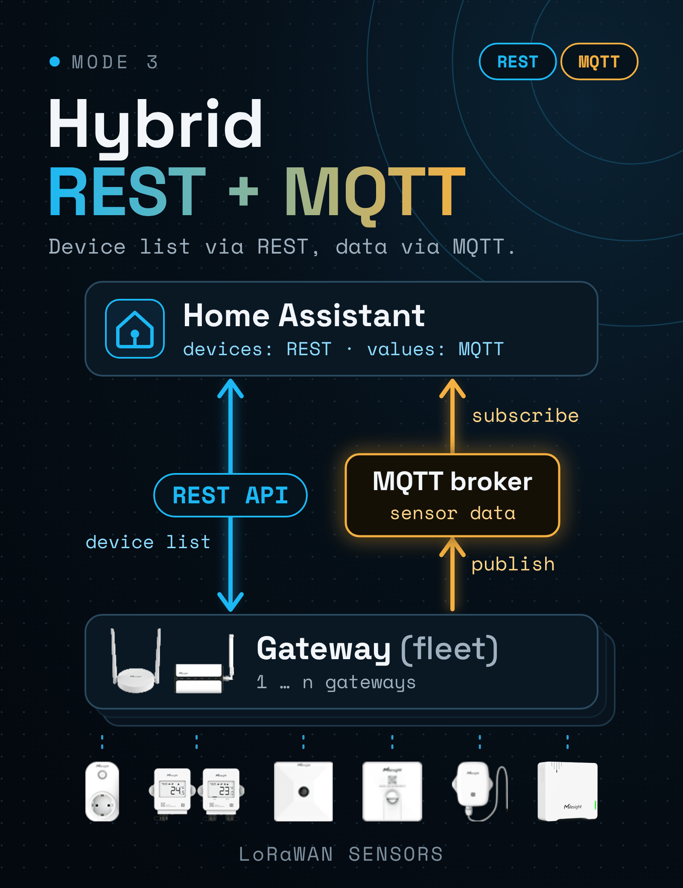
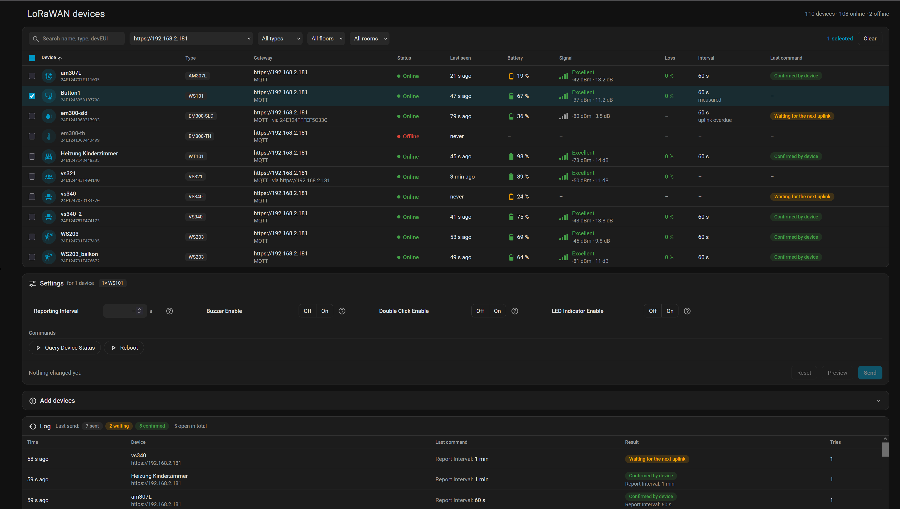
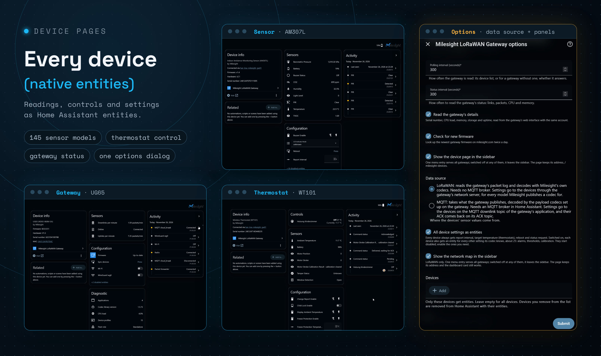

<p align="center">
  
</p>

# Milesight Gateway for Home Assistant

[](https://my.home-assistant.io/redirect/hacs_repository/?owner=corgan2222&repository=ha-milesight-gateway&category=integration)
[](https://my.home-assistant.io/redirect/config_flow_start/?domain=milesight_gateway)

Brings Milesight LoRaWAN gateways (UG65, UG67 and their relatives) and the
sensors behind them into Home Assistant: sensor values, device settings, the
gateway's own status and a map of the radio network.



## Features

- **Sensors of 145 Milesight models**, decoded with Milesight's own codecs
- **Three modes**: REST straight from the gateway with no broker at all, MQTT through your broker, or both
- **No custom payload codec needed**: the gateway's built-in codecs already deliver RSSI, SNR, data rate and frame counter
- **Devices page**: set many devices at once, follow each command until the device confirms it, add devices to the gateway
- **Network page** and dashboard card with RSSI and SNR of every reception
- **Link and battery**: signal quality, packet loss, gateways in range, battery days left; pulse counters as water, gas or energy meters
- **Gateway status**: packet forwarder, MQTT links, fleet gateways, CPU, memory, storage, firmware updates
- Set up entirely in the UI; on a fleet with hundreds of sensors, only the picked ones get entities

## Requirements

- Home Assistant 2026.9.0 or newer
- A Milesight LoRaWAN gateway with firmware 60.0.0.42 or newer, reachable from Home Assistant
- The gateway's login and its AES Secret Key and IV (from the gateway's security settings)
- For the MQTT mode only: the [MQTT integration](https://www.home-assistant.io/integrations/mqtt/) and the gateway publishing to your broker

## Installation

The integration is in the Marketplace default list. In the Marketplace, search for **Milesight
Gateway**, download it and restart Home Assistant. Without the Marketplace, copy
`custom_components/milesight_gateway` into `config/custom_components/` and
restart.

## Setup

**Settings → Devices & services → Add integration → Milesight Gateway**.

| Field | Description | Default |
| ----- | ----------- | ------- |
| Gateway URL | `http://` or `https://` and the address, without port, for example `https://192.0.2.10` | |
| Port | Port of the gateway's HTTP API | `8080` |
| Username, password | The gateway login | |
| Secret Key, IV | 16 characters each, from the gateway's security settings | `1111111111111111`, `2222222222222222` |

A second step asks for the mode and lists the gateway's devices, searchable
by name, model and devEUI. Pick the ones that should get entities, or leave
the list empty for all. **Reconfigure** changes address, login, key or IV
later and keeps all devices and entities.

## Modes: REST, MQTT and hybrid

| LoRaWAN REST | MQTT standalone | Hybrid |
| :---: | :---: | :---: |
|  |  |  |

Each gateway entry runs in one mode. The options call it the data source;
REST is listed there as **LoRaWAN**, hybrid as **MQTT**. MQTT standalone is
an entry with the web login only, such as a UG63; its devices come in over
MQTT alone.

| | MQTT | REST |
| --- | --- | --- |
| Values arrive | The gateway publishes each uplink to your broker | The integration reads the network server's packet log every 10 seconds |
| Decoded by | The payload codecs on the gateway; raw payloads are decoded here | Milesight's codecs, bundled in [Milesight-Gateway-API](https://github.com/corgan2222/Milesight-Gateway-API) |
| Settings go out | On the application's downlink topic | Through the network server's queue |
| Confirmation | The application's ACK topic | The ACK in the packet log |
| Needs | A broker and the MQTT integration | Nothing but the gateway |

In MQTT mode the integration reads the topics from the gateway's MQTT
application, and the gateway's own status still comes over its API. Use MQTT
when the broker runs anyway, REST for a quick start without one.

Switch the mode under **Configure**. Fields both modes know keep their entity,
entity ID and history.

## Devices page

The **LoRaWAN devices** page in the sidebar lists every device of every entry:
type, gateway and the gateway that received it, online state, battery, signal,
packet loss, report interval and the state of the last command.

- Tick devices, or the box in the header for all online ones shown, and set
  what their models have. A setting only some of them have names the types.
- **?** explains a setting; a click on it adds the range and an example value.
- **Preview** shows the bytes, **Send** queues them. A LoRaWAN device only
  listens right after it sends, so the column **Interval** tells when its next
  uplink is due.
- Each command is followed: *waiting for the next uplink*, *delivered*,
  *acknowledged*, *confirmed by device* once the device reports the new value.
  The log counts what is still open.
- Sent settings are kept over a restart. **Add devices** creates devices on
  the gateway from a list of devEUIs; the gateway's **Sync devices** button
  removes the ones the gateway no longer has.



Only administrators see the page. An option takes it out of the sidebar; it
stays at `/milesight-devices`.

## Network page

In REST mode, a **LoRaWAN network** page shows every gateway of each entry and
the devices around the gateway that hears them best. Each reception is a line
with RSSI and SNR, coloured by the weaker of the two:


| Colour | RSSI | SNR |
| ------ | ---- | --- |
| green | from −100 dBm | from 0 dB |
| yellow | from −110 dBm | from −5 dB |
| orange | from −120 dBm | from −10 dB |
| red | below | below |

The same map works as a dashboard card, loaded by the integration itself:

```yaml
type: custom:milesight-lorawan-map
gateway: https://192.0.2.10   # entry title or ID; all entries when left out
height: 500px
title: Fleet                   # empty hides the title
labels: true                   # RSSI and SNR on the lines
```

On Home Assistant 2026.11 or newer, a REST entry also registers with Home
Assistant's own LoRaWAN integration.

## Devices and entities

Every device gets its readings as sensors and binary sensors, buttons such as
the WS101 an event entity, and diagnostics: last seen, RSSI, SNR, spreading
factor, signal quality, packet loss, gateways in range, battery days left and
the state of the last command. A pulse counter can serve the energy dashboard
as a water, gas or energy meter. A people counter also tells occupancy: on
from one person. The regions and line crossings of a workplace sensor such as
the VS121 start disabled; enable the ones you drew in its image.



The essential settings are entities from the start: report interval, reboot,
status request, and the target temperature of a thermostat. Most devices
report their settings only when asked, so one can show as unknown until then;
it can be changed anyway.

### WT101 radiator thermostat

- The thermostat entity sets the target temperature; setting one switches the
  valve from manual mode to regulation.
- **Manual valve opening** moves the valve directly while temperature control
  is off. **Outside temperature** feeds a room temperature from another sensor.
- The valve position stays unknown until the thermostat is mounted and
  calibrated.

## Gateway

The gateway device carries online and offline device counts, the packet
forwarder, uplinks and downlinks per minute, an MQTT link per application, one
device per fleet gateway, CPU load, memory, storage and last boot, and a
firmware update entity. A failing status call makes only these entities
unavailable, not the devices.

The update entity installs the firmware Milesight offers. It downloads a full
backup of the gateway first and keeps it in `milesight_gateway_backups` under
the configuration folder; the backup holds keys and passwords. Where the
newest firmware needs a minimum version, the entity offers that version first
and the newest one after it. The gateway restarts, which takes a few minutes.

On a fleet, every member gets its own device with what the hub knows about it
(WAN, address, last boot) and what its own web interface reports: CPU load,
memory, storage, firmware with its own update entity, and switches for Wi-Fi
and WireGuard. The members are logged in to with the hub's account.

## Options

| Option | Description | Default |
| ------ | ----------- | ------- |
| Data source | MQTT or LoRaWAN (REST), see above | LoRaWAN for new entries |
| Devices | Only these devices get entities | all |
| All device settings as entities | Adds about 25 settings per device, disabled until you enable them | off |
| Polling interval, status interval | How often device list and gateway status are read, in seconds (min. 60) | `300` |
| Read the gateway's details | Logs in to the web interface for CPU, memory, storage and serial number | on |
| Check for new firmware | Looks up the newest gateway firmware on milesight.com | on |
| Show the device page, the network map in the sidebar | One menu entry each for all gateways | on |

## Troubleshooting

Attach the diagnostics to an issue: **Settings → Devices & services →
Milesight Gateway → ⋮ → Download diagnostics**. Passwords, keys, addresses,
serial numbers, EUIs and names are removed.

- **Setup fails:** check address, port, login, Secret Key and IV.
- **A device is offline:** neither the gateway nor Home Assistant heard it within the gateway's device timeout.
- **A setting does not change:** it reaches the device after its next uplink. *Acknowledged* without *confirmed* means the frame arrived; a value outside the device's range is acknowledged and dropped.
- **A device is missing:** models without a codec are skipped. Debug logging for `custom_components.milesight_gateway` names them.

## Removal

**Settings → Devices & services → Milesight Gateway → ⋮ → Delete** removes the
entry with all its devices and entities. Nothing is left on the gateway.

## Contributing and credits

See [CONTRIBUTING.md](CONTRIBUTING.md). The gateway communication lives in
[Milesight-Gateway-API](https://github.com/corgan2222/Milesight-Gateway-API)
([PyPI](https://pypi.org/project/Milesight-Gateway-API/)). The device codecs
are Milesight's own, from [Milesight-IoT/codec](https://github.com/Milesight-IoT/codec) (MIT).

Only a few of the supported sensor models have been tested on real hardware.
If a model misses a value, please open an issue with the diagnostics.

## License

See [LICENSE](LICENSE).
